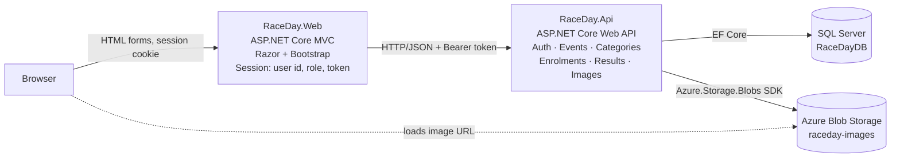

# 🌸 RaceDay — Web-Based Event Management System

RaceDay is a full-stack event management system for South African road-running, walking and cycling events.
This repository contains all three parts of the **PROG6212 Programming 2B Portfolio of Evidence**:

| Part | What | Where |
|---|---|---|
| **1** Planning & database | ERD, API endpoint plan, SQL Server script | `docs/`, `database/RaceDayDB.sql` |
| **2** RESTful API | ASP.NET Core 8 Web API, EF Core, session-based JWT auth, Swagger, tests | `RaceDay.Api/`, `RaceDay.Tests/` |
| **3** Web application | ASP.NET Core MVC site (Bootstrap 5), Azure Blob Storage via the API, Docker | `RaceDay.Web/`, `RaceDay.Web.Tests/` |

> 📺 **Video demonstration (unlisted YouTube):** _paste your link here_
> ✅ **CI:**  · screenshot of a green run: `docs/screenshots/ci-green-build.png` _(add after your first green run)_

---

## Architecture



* **The MVC site has no database access and no Azure SDK.** Every read, write and upload goes through the Part 2 API, using the typed client in `RaceDay.Web/Services/RaceDayApiClient.cs`. CI fails the build if `RaceDay.Web` ever references EF Core, SqlClient or Azure Storage.
* **The API owns the business rules.** Examples are ownership checks, capacity, age limits, race-day rules and image validation. The MVC site only formats the results and adds quick browser-side checks.
* **Images:** MVC form (`IFormFile`) → `POST /api/events/{id}/banner` or `POST /api/users/me/photo`. The API checks the size (5 MB) and the real file signature (JPEG/PNG/WebP/GIF; SVG is rejected), uploads to Azure Blob Storage, and saves the **blob URL in SQL Server** (`Event.BannerImageUrl`, `Participant.ProfileImageUrl`, `Organiser.ProfileImageUrl`). MVC then displays that URL. Replacing an image deletes the old blob.

## Repository structure

```
RaceDay.sln
├── database/RaceDayDB.sql          SQL Server script (v3: + ProfileImageUrl columns)
├── docs/                           ERD, endpoint plan (34 endpoints), Part 1 report, guides, screenshots
├── RaceDay.Api/                    Part 2 API (+ Part 3 image uploads)   · Dockerfile
│   ├── Controllers/                Auth, Users, Events, Categories, Enrolments, Results, Media, Health
│   ├── Services/                   Business rules, ImageStorage (Azure Blob), MediaService
│   └── Data/                       RaceDayDbContext, DbSeeder
├── RaceDay.Web/                    Part 3 MVC website                    · Dockerfile
│   ├── Controllers/                Home, Account, Events, Enrolments, Results, Profile
│   ├── Areas/Organiser/            Dashboard, Events, Categories, Enrolments, Results
│   ├── Services/RaceDayApiClient   The only data source: the Part 2 API
│   ├── Infrastructure/             Session sign-in, RequireLogin/RequireRole filters, API error filter
│   ├── Views/                      Razor views, shared layout with role-based menus
│   └── wwwroot/                    Bootstrap 5.3, Bootstrap Icons, theme CSS, sporting illustrations
├── RaceDay.Tests/                  102 API tests (unit + integration)
├── RaceDay.Web.Tests/              35 MVC tests (session, menus, redirects, API client)
├── docker-compose.yml              SQL Server + Azurite + API + MVC
└── .github/workflows/ci.yml        Structure check → build + test → Docker build + container smoke test
```

## Features

### Authentication and role-based navigation
* Registration (pick **Participant** or **Organiser**) and login both go through the API (`/api/auth/register`, `/api/auth/login`).
* After login the **ASP.NET Core session** stores the user's **ID, role**, name and API token on the server. The browser holds only an HttpOnly session cookie.
* Each role sees its own menu:

| Organiser | Participant | Visitor |
|---|---|---|
| Dashboard · Manage Events · Manage Categories · View Enrolments · Capture Results · Profile · Logout | Home · Browse Events · My Enrolments · My Results · My Profile · Logout | Home · Browse Events · Log in · Sign up |

* `[RequireLogin]` sends visitors to the login page and returns them to the page they asked for afterwards; external return URLs are ignored. `[RequireRole("Organiser")]` and `[RequireRole("Participant")]` send the wrong role to an Access Denied page.
* The API still enforces roles and ownership on every call. For example, an organiser can't edit another organiser's event even by typing the URL.
* **Logout** revokes the API session (the token stops working), clears the MVC session and cookie, and redirects to Home. If the API session expires, the next request logs the user out cleanly and sends them to Login.
* Anti-forgery tokens protect every POST, and the API's cookies are never shared between website users (`UseCookies = false`).

### Organiser interface (`/Organiser`)
* **Dashboard:** totals, the next upcoming event dates, enrolments per event, and all events with quick actions.
* **Manage Events:** create, edit and delete events with name, description, date, start time, location, distance and type (run, walk or cycle). Publish, mark as completed or cancel an event, and **upload a banner** on create or edit.
* **Manage Categories:** add, edit and delete age and/or distance categories per event, with quick templates (Under 20, Senior, Veterans, 5 km, 10 km, 21 km).
* **View Enrolments:** participants for the selected event with bib, contact, category and colour-coded status, filterable by category and status.
* **Capture Results:** enter the finish time and position per participant (or DNF/DNS/DQ), then mark the event completed. Results are published to participants immediately and appear on the public event page.

### Participant interface
* **Home:** upcoming events with filters (type, search, location, date range).
* **Browse Events:** all events, including completed ones. **Event Details** shows the full information, categories, spots left and the leaderboard.
* **Enter Event:** choose a category and confirm. A bib number is issued and the entry is recorded immediately.
* **My Enrolments:** upcoming and past entries with colour-coded statuses; an entry can be cancelled before race day.
* **My Results:** event, date, category, finish time, position (e.g. *47th out of 312 finishers*), pace, and personal totals.
* **My Profile:** update personal details, change password, and **upload a profile picture** (stored in Azure Blob Storage).

### UI design
* A blush-pink, lilac and peach RaceDay brand on **Bootstrap 5.3**: Poppins/Nunito fonts, consistent cards, buttons, tables and spacing, and sporting illustrations (runners, walkers, cyclists, finish bunting).
* **Colour-coded statuses** that never rely on colour alone (icon + text): ✅ Confirmed (green), ⏳ Pending (amber), ~~Cancelled~~ (muted with strikethrough), plus Upcoming, Draft and Completed.
* Responsive from 360 px phones to desktop, with a collapsible menu and scrollable tables.
* Friendly validation, friendly 404/500 pages and a "service unavailable" page. Raw errors are never shown to users.

Screenshots are in `docs/screenshots/`.

---

## Running locally

**Requirements:** .NET 8 SDK, SQL Server (Express or LocalDB) and SSMS, and Azurite or an Azure Storage account.

1. **Database:** open `database/RaceDayDB.sql` in SSMS and run it. It creates `RaceDayDB` with seed data.
2. **Azure Blob Storage:**
   * Local emulator: Visual Studio 2022 starts **Azurite** automatically. Otherwise install and run it:
     ```bash
     npm install -g azurite
     azurite-blob --loose
     ```
     `appsettings.Development.json` already points to it (`UseDevelopmentStorage=true`).
   * Real Azure: create a Storage account and copy its connection string, then set it as a user secret so it never lands in Git:
     ```bash
     dotnet user-secrets set "Storage:ConnectionString" "<your connection string>" --project RaceDay.Api
     ```
     The `raceday-images` container is created automatically. If the account blocks anonymous blob access, the API automatically uses read-only SAS URLs.
3. **Run both projects** (in Visual Studio: *Configure Startup Projects → Multiple*):
   ```bash
   dotnet run --project RaceDay.Api --launch-profile "RaceDay.Api (SQL Server + Azure Blob)"   # http://localhost:5080/swagger
   dotnet run --project RaceDay.Web                                                           # http://localhost:5180
   ```

No SQL Server at hand? Use `--launch-profile "RaceDay.Api (In-memory demo)"`. It runs with seed data in memory and stores images on local disk. This is for quick demos only; the assessed setup is SQL Server with Azure Blob Storage.

### Demo accounts

All seeded accounts use the password **`RaceDay@2026`**.

| Role | Email |
|---|---|
| Organiser | `thabo.mokoena@example.com`, `lerato.nkosi@example.com` |
| Participant | `sipho.dlamini@example.com`, `amahle.khumalo@example.com`, `zanele.mthembu@example.com` |

---

## 🐳 Docker

**Whole system with one command** (SQL Server, Azurite, API and MVC; the database script runs automatically):

```bash
docker compose up --build
```

| Service | URL |
|---|---|
| **RaceDay website (MVC)** | http://localhost:8081 |
| API + Swagger | http://localhost:8080/swagger |
| Azurite blob endpoint | http://localhost:10000/devstoreaccount1 |

**MVC container on its own**, talking to an API running on your machine:

```bash
docker build -f RaceDay.Web/Dockerfile -t raceday-web .
docker run --rm -p 8081:8080 -e Api__BaseUrl=http://host.docker.internal:5080/ raceday-web
```

Both Dockerfiles use multi-stage builds (SDK image to build, small ASP.NET runtime image to run). The restore layer is cached separately, the app runs as a non-root user on port 8080, and `.dockerignore` keeps `bin/`, `obj/`, secrets and docs out of the build context. To use a real Azure account in Docker, put `AZURE_STORAGE_CONNECTION_STRING=...` in a `.env` file (git-ignored) and set `AZURE_STORAGE_PUBLIC_BASE_URL=` to empty. On Apple Silicon Macs, enable Rosetta in Docker Desktop for the SQL Server image.

---

## Tests and CI/CD

```bash
dotnet test
```

| Project | Covers |
|---|---|
| `RaceDay.Tests` (102) | Registration and login, hashing, sessions and logout, role and ownership rules, event, category, enrolment and result rules, image validation, banner and photo uploads (with an in-memory storage fake), leaderboard, Swagger lists every endpoint |
| `RaceDay.Web.Tests` (35) | Protected pages redirect to login, organiser and participant menus, wrong role sent to Access Denied, the token is forwarded to the API, return URLs are safe, logout clears the session, anti-forgery is enforced, friendly 404, API error mapping, filters, multipart upload |

`.github/workflows/ci.yml` runs on every push and pull request:

1. **Structure:** checks that the required files exist and that the MVC project has no database or Azure SDK access.
2. **Build & test:** builds the whole solution (API, **MVC**, tests) and runs both test projects. TRX and coverage results are uploaded as artifacts.
3. **Docker:** builds the API and MVC images, runs both containers on one network, and smoke-tests that the containerised website renders pages using the containerised API.

## Configuration reference

| Setting | Project | Purpose |
|---|---|---|
| `ConnectionStrings:Default` | API | SQL Server connection |
| `Jwt:Key` | API | Token signing key (32+ chars; user-secrets or env var) |
| `Storage:ConnectionString` | API | Azure Storage or Azurite connection (**never commit a real one**) |
| `Storage:ContainerName` / `PublicBaseUrl` / `MaxImageBytes` | API | Container name, public URL rewrite (Docker + Azurite), upload limit |
| `Api:BaseUrl` | Web | Where the MVC site finds the API |
| `Session:IdleTimeoutMinutes` | Web | Session idle timeout (default 60) |

## Documents

* `docs/RaceDay_Part1_Revised.pdf`: Part 1 (ERD, endpoint plan, SQL notes, change log)
* `docs/API_Endpoint_Plan.md` / `docs/RaceDay_API_Endpoint_Plan.pdf`: all 34 endpoints
* `docs/Part2_Video_Guide.md`, `docs/Part3_Video_Guide.md`: suggested video running orders
* `docs/Part3_Commit_Plan.md`: how to build up 20+ meaningful Part 3 commits on a `part3` branch

> **Academic integrity:** follow the IIE's rules on declaring AI assistance, and make sure you can explain every part of this code in your videos.
